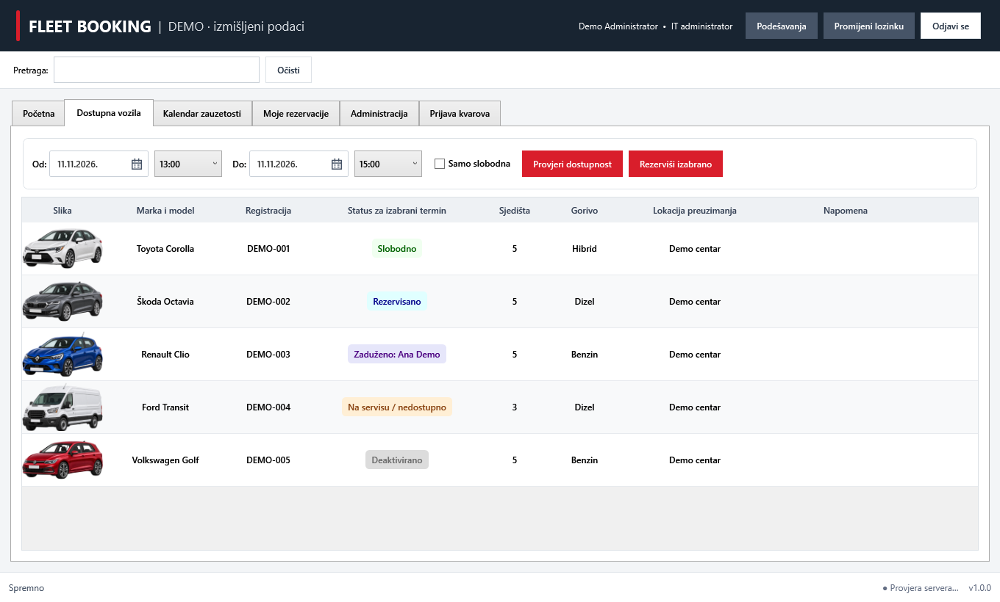
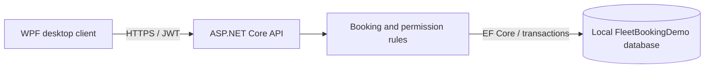

# Fleet Booking Demo

A Windows desktop application for booking shared company vehicles, backed by an ASP.NET Core API and SQL Server. This portfolio edition uses a fictional company, synthetic accounts and `DEMO-001` style vehicle identifiers.

The desktop application talks only to the API. Booking rules and permissions are enforced on the server, and SQL transactions prevent two API processes from reserving the same vehicle at the same time.



The screenshot is rendered from the WPF controls with synthetic layout fixtures; it is not a capture of a business environment.

## Features

- Administrator and employee roles, JWT authentication and password hashing.
- Daily, weekly and monthly calendars, vehicle availability and upcoming bookings.
- Booking creation, changes and cancellation with retained history.
- Assigned vehicles, maintenance periods, vehicle issues and an audit trail.
- Optional encrypted local session storage and personal table preferences.
- Demo data: three accounts, five vehicles with bundled illustrations, five bookings, one maintenance period and one vehicle issue.

The interface is in Montenegrin. This edition contains the Windows client, API and tests; mobile clients and production deployment scripts are outside its scope.

## Quick start

Requirements: Windows 10/11, .NET 10 SDK, Python 3.10+ for the publication check, and a local SQL Server Express instance named `SQLEXPRESS`. Your Windows account must be able to create the separate `FleetBookingDemo` database. The launcher does not install or start SQL Server.

On first use, create and trust the local development certificate:

```powershell
dotnet dev-certs https --trust
```

Then run **Pokreni demo.cmd**, or:

```powershell
powershell -NoProfile -ExecutionPolicy Bypass -File scripts/Start-Demo.ps1
```

The launcher builds the solution, starts the API on `https://localhost:58443/`, opens the desktop client and stops its own API process after the client closes. It generates a random password locally. Read `.local/demo-access.txt` for access details:

| Account | Role |
| --- | --- |
| `admin@example.com` | Administrator |
| `ana@example.com` | Employee |
| `luka@example.com` | Employee |

The initial password is shared by these fictional demo accounts only. It is never included in the public package. Existing data and password hashes remain unchanged on subsequent starts. Bookings are seeded relative to the first run date; they do not move forward every day.

All five vehicle illustrations are bundled transparent PNG cutouts, so no external image service is required. The desktop trims transparent margins when displaying them and uses more of each image cell to keep the vehicles readable. Restarting an older demo installation adds missing images and replaces only the exact previous bundled images with the new cutouts. Existing custom images, accounts and bookings are preserved. These are AI-generated illustrations with blank plates, not photographs of business vehicles. See [image provenance and prompts](docs/IMAGES.md).

For API-only use, add `-NoClient` to the PowerShell command and press Ctrl+C when finished. API startup logs remain in the ignored `.local` folder. Desktop sessions and preferences live in `.local/client` beside the client executable.

## Try a complete workflow

1. Sign in as Ana and inspect tomorrow's bookings.
2. Create a booking in a free time slot.
3. Try an overlapping booking for the same vehicle; the API rejects it.
4. Cancel the first booking; its history remains, and the time slot becomes available.
5. Sign in as administrator to inspect users, maintenance, vehicle issues and the audit trail.

## Architecture



| Project | Responsibility |
| --- | --- |
| `src/FleetBooking.Shared` | API contracts, shared validation and demo endpoint rules |
| `src/FleetBooking.Api` | Authentication, permissions, booking logic, migrations and synthetic seeding |
| `src/FleetBooking.Client` | WPF interface and encrypted local demo session storage |
| `tests/FleetBooking.Tests` | Business rules, API authorization, concurrent updates and demo isolation |
| `tests/FleetBooking.Client.Smoke` | WPF layout and control checks using synthetic fixtures |

All times are stored as UTC and displayed in the Europe/Podgorica time zone. Two intervals overlap when `existingStart < newEnd && existingEnd > newStart`; adjacent bookings are allowed. Booking changes acquire an in-process lock, a serializable transaction and a SQL Server application lock per vehicle.

## Build and test

```powershell
dotnet build FleetBooking.sln
dotnet test tests/FleetBooking.Tests/FleetBooking.Tests.csproj
dotnet run --project tests/FleetBooking.Client.Smoke
python scripts/verify_public.py --self-test
python scripts/verify_public.py
```

The default API tests use isolated in-memory databases. To also exercise SQL migrations and cross-connection booking locks against a local SQL Express instance:

```powershell
powershell -NoProfile -ExecutionPolicy Bypass -File scripts/Test-Demo.ps1 -Sql
```

SQL tests create uniquely named `FleetBookingTest_*` databases and remove them afterwards. They do not use the demo database or any business database.

## Prepare a public package

```powershell
python scripts/verify_public.py
python scripts/package_public.py
```

The ZIP is created under `artifacts/FleetBookingDemo-source.zip`. Only files listed in `PUBLIC_FILES.txt` are included. Database files, local credentials, logs, build output and Git history are excluded. Packaging refuses unlisted source files or modified files whose checksums no longer match the reviewed manifest.

See [privacy and publication notes](docs/PRIVACY.md) and [local verification results](docs/VALIDATION.md). This is a local portfolio demonstration. It is not configured for public hosting or real employee records.
